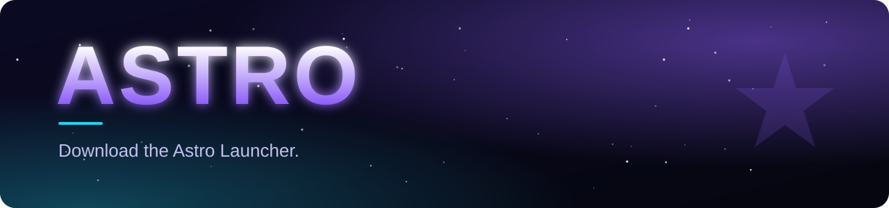

<!-- spiced -->

  

  
  
  

<h3 align="center">Installers and auto-update files for the Astro Launcher, a fast, purple Minecraft launcher with a built-in Fabric client.</h3>

<b>⭐ Like it? <a href="https://github.com/Vortexyyy/astro-releases/stargazers">Drop a star</a>. It's free, takes a second, and helps others find it. ⭐</b>

---

## 📥 Download

1. Open the **[latest release](https://github.com/Vortexyyy/astro-releases/releases/latest)**.
2. Download **`Astro-Setup-<version>.exe`** and run it.
3. Sign in with Microsoft, create a profile, press **Launch**.

The launcher **updates itself** from this repo, so you only ever install once.

> Windows may show a SmartScreen prompt for new, unsigned installers. Choose *More info*, then *Run anyway*.

## ✨ What you get

- One-click play, a built-in mod browser (Modrinth and CurseForge) and one-click performance mods.
- The Astro in-game client: Right Shift mod menu, HUD, zoom, freelook and more, for Minecraft 1.21.1 / 1.21.10 / 1.21.11.
- Encrypted sign-in, backups through your own cloud folder, and no telemetry.

## 🛠️ Source code

The full source, screenshots and developer guide live in **[Vortexyyy/astro-client](https://github.com/Vortexyyy/astro-client)**.
This repo only holds the built installers.

## 💜 Support

- ⭐ **[Star this repo](https://github.com/Vortexyyy/astro-releases/stargazers)** so more people can find it.
- 🐛 **[Open an issue](https://github.com/Vortexyyy/astro-releases/issues)** for bugs or ideas.
- 📣 Share it with a friend.

  

